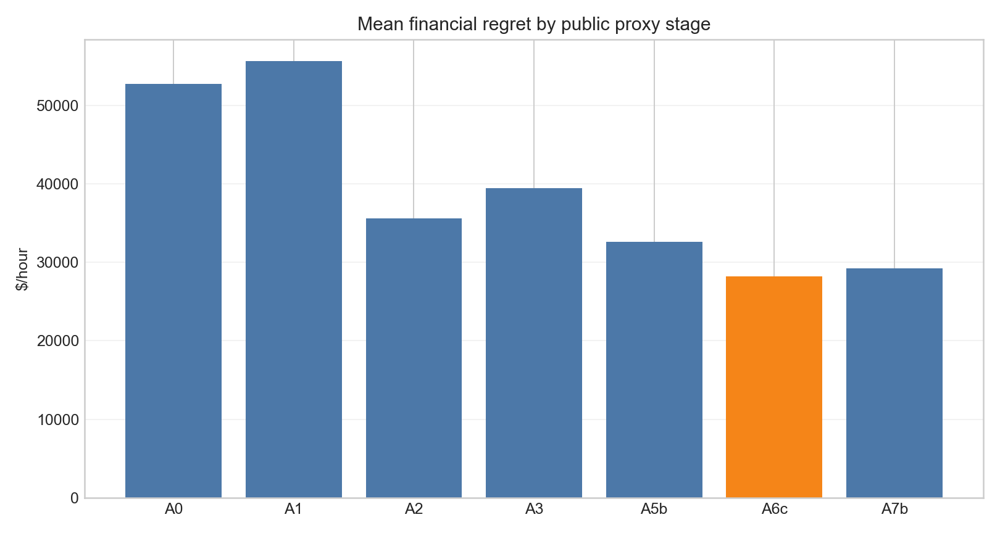
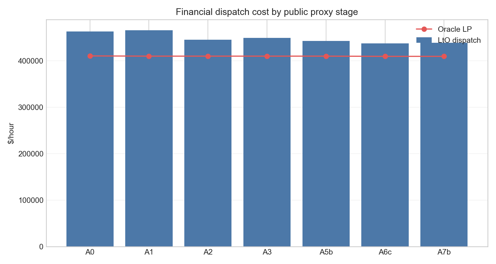
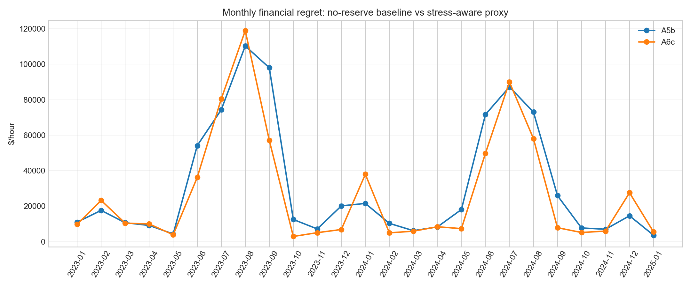
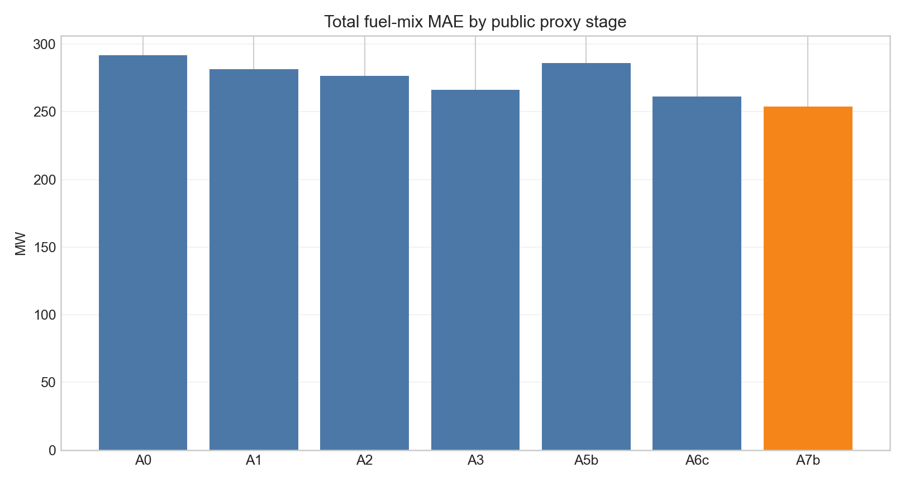
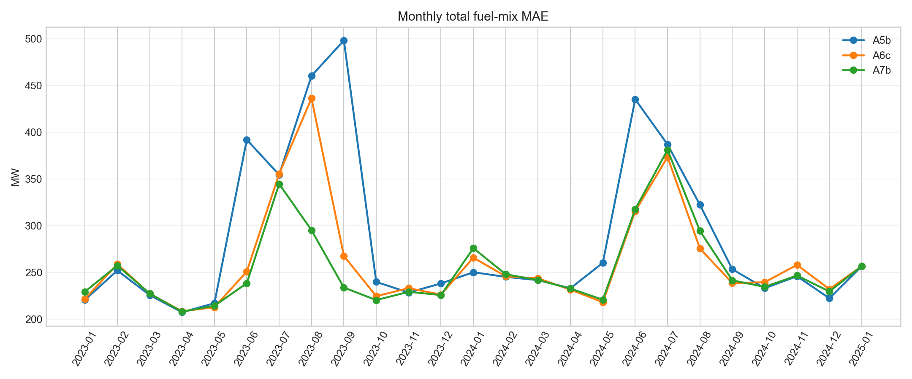

# Power Grid Dispatch Model

Every hour, New York has to decide which power plants turn on, and how much each one runs. The people who make that call see private bids from the plant owners. I did not. I had the public record: how much electricity each region used, what fuel prices did, which plants were scheduled offline, and how hard the lines between regions were working.

The job was to build an hourly plan from that record and see if it could beat the old schedule on cost.

A plan only counts if the grid could actually run it. I held every version to the same four rules.

- **Meet demand.** Each region has to get the power it is expected to use that hour. Power can move between regions, but what leaves one region has to arrive in another.
- **Respect the lines.** The lines between regions have published limits. The plan cannot push more power across a line than that line can carry.
- **Stay inside the plants.** A plant cannot run above the capacity that is actually available, and it cannot jump from last hour's output faster than plants of that type have historically moved.
- **Hold a reserve.** Some capacity has to sit ready in case a plant trips or demand comes in high. The plan I kept holds back spare room equal to 2% of that hour's demand. It is not allowed to run every plant flat out.

## How the plan gets made

I did not ask a model to write the hourly plan. I asked it to estimate what it costs to run each kind of plant, and I let an optimizer write the plan. That split is the method. People call it a learning-to-optimize pipeline. The model learns the costs. The optimizer is the part that has to obey the four rules above.

One hour goes through five steps.

1. Read the public record for that hour: demand by region, weather, fuel prices, scheduled outages, and whether the lines were already under stress.
2. A small model turns that hour into a cost for each fuel in each region. There are eleven regions and seven fuels, so that is one cost per region and fuel.
3. An optimizer takes those costs and picks how many megawatts to run. It has to meet demand, stay under the line limits, stay inside each plant, and leave the reserve. The cheapest plan that still does all four is the one I keep for that hour.
4. I solve the same hour a second time, using the public fuel costs instead of the model's costs, under the same four rules. That second plan is the cheapest one the public data allows. It is what I grade against.
5. I compare the two plans. If the model's costs sent the optimizer to a more expensive mix, I update the model so the next guess points closer to that cheapest plan.

I trained on 720 hours from 2020 and 2021, three passes through those hours. I checked 2022, then scored 2023 and 2024. The plan I kept only learns the costs. The 2% reserve is a fixed rule, not a number the model invents. I also tried letting the model pick its own reserve. That version is in the charts below, and it cost more.

## Conclusion

The plan I kept is the ordinary one. It respects the power lines, and it holds back a reserve equal to 2% of that hour's demand.

On 2023 and 2024, that plan left less money on the table than the old schedule. The gap versus the cheapest plan the public data would allow fell from $52,755 an hour to $28,189 an hour. That is a 47% smaller gap. The bill for generating the power barely moved, from $463,109 an hour to $437,598. So this is not "the power bill fell by half." The old plan was quietly expensive relative to the best plan available. The new one is less quietly expensive. Every version I compared still produced a workable schedule for every hour.

The versions that look smarter were worse business. A plan that copied the historical fuel mix more closely cost about $20,500 more per hour. Letting the model pick its own reserve also cost more than just using 2%. Matching the past, and a fancier model, were not the cheaper way to run the system.

A utility or a trading desk that cannot see private bids can use this the same way: draft the hourly plan from the public record, force it to obey the lines and a small reserve, and grade it on dollars left above the cheapest workable plan. Do not grade it on whether the mix of gas, hydro, and wind looks like last year. This does not replace the software the grid operator actually runs.

## What the charts are

Each bar or line is one version of the plan. **A0** is the old schedule. **A6c**, the orange bar, is the plan I kept: line limits plus a 2% reserve. The letters in between are the versions I tried on the way there. Shorter is better when the chart is about cost.

| Version | What I changed | Bill ($/hr) | Left on the table ($/hr) |
| --- | --- | ---: | ---: |
| A0 | Old schedule | 463,109 | 52,755 |
| A1 | Newer public list of plant capacity | 465,540 | 55,674 |
| A2 | Limits on the lines between regions | 445,503 | 35,637 |
| A3 | Day-ahead stress on those lines | 449,337 | 39,470 |
| A5b | Plants known to be offline | 442,472 | 32,606 |
| **A6c** | **Hold back 2% as reserve** | **437,598** | **28,189** |
| A7b | Let the model choose the reserve | 438,679 | 29,270 |

### Money left on the table

This is the chart behind the 47%. Each bar is one version. The orange bar is the plan I kept, and it is the shortest. The chart's own title says "regret." That word means the same thing as the column above: dollars per hour above the cheapest workable plan. It is not the power bill.



### The actual bill

Same versions, but this time the bars are the full cost of generating the power. The red line is the cheapest workable plan. The bars look almost the same height because a $25,000 gap is small next to a $440,000 bill. That is why the first chart exists. The bill chart hides the result. The orange bar is still the one I kept.



### Did the reserve help every month?

Blue is the plan with line limits and outages, and no reserve. Orange is that same plan plus the 2% reserve. Orange is lower most months, which is why I kept it. It is not lower every month. Both lines spike in the summers.



### Copying the fuel mix is a different goal

These two charts are not about the bill. They ask how many megawatts off the plan was from the mix of fuels New York actually published. Lower means a closer copy of history. Letting the model choose the reserve (A7b) wins that contest. It also costs more, which is why it is not the plan I kept. A6c is the next best on this chart and the best on the money chart.





## Code

`run_zonal_cost_lto.py` trains the cost model and solves each hour. `nyiso_processing.py` and `nyiso_cost_processing.py` turn the public files into those hours. The charts above live in `figures/final_scuc_proxy/`.

The other pictures in `figures/` are an earlier attempt. That attempt guessed the next fuel mix and then patched the guess. It is not the plan in the table.

The hourly data files are large and are not in this repository. The scripts expect them under `data/processed/`.

```bash
pip install -r requirements.txt
```
